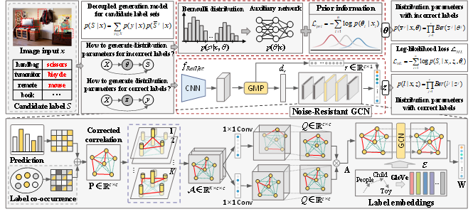

## NRGD--Noise-Resistant GCN-Guided Candidate Label Generation Decomposition for Instance-Dependent Partial Multi-Label Learning

## Abstract
Partial multi-label learning (PML) associates each training sample with a set of candidate labels, only some of which are correct. Existing PML methods assume that the wrong labels in each training example are randomly selected as candidate labels. However, this assumption is unrealistic, as real-world noise is always instance-dependent. This paper first investigates the instance-dependent PML (ID-PML) problem by exploring the candidate label generation process. During generation, the annotator first considers the correct labels related to the instance; then, due to label uncertainty, some instance-dependent but incorrect labels are inadvertently included in the candidate set. Based on this, we explicitly model the distribution of correct and incorrect labels for each instance by decoupling two distinct Bernoulli distributions. Nevertheless, the initial modeling of the correct label distribution still implicitly relies on the independence assumption, thereby neglecting semantic relationships between labels. Therefore, we propose a noise-resistant GCN-guided candidate label generation decomposition (NRGD) method for ID-PML. We introduce a Noise-Resistant GCN that dynamically refines label graphs via prediction, ensuring that the correct label generation is structurally guided by noise-free dependencies. Then, we transform NRGD into a MAP problem and leverage the conjugacy between the Bernoulli and the Beta distribution to achieve distribution parameter estimations. Finally, we design two ID-PML noise generations, part-dependent and classification-based, and conducted extensive experiments on manually corrupted benchmark and realistic datasets.



## Dataset
To evaluate/train DGCL, first, the [VOC2012/2007](http://host.robots.ox.ac.uk/pascal/VOC/) and [MSCOCO](https://cocodataset.org/#download) datasets need to be downloaded. Then directly run the following command to generate json file (for implementation) of these datasets.
```
python utils/prepare/prepare_voc07.py  --data_path  Dataset/VOCdevkit
python utils/prepare/prepare_voc12.py --data_path Dataset/VOCdevkit
python utils/prepare/prepare_coco.py --data_path  Dataset/COCO2014
```
Please note that the generated json file is initially in `utils/prepare`, please move it to `data/voc12` manually. In addition, for VOC2012 dataset, since the test set is VOC2007, please directly move the `test_voc07.json` generated in voc07 to `data/voc12` without renaming.

```
Shell
├── Dataset
    ├── VOCdevkit
        ├── VOC2007
            ├── Annotations
            ├── ImageSets
            ├── JPEGImages
                ├── 0000001.jpg
                ...
            ├── SegementationClass
            ├── SegementationObject
        ├── VOC2012
            ├── Annotations
            ├── ImageSets
            ├── JPEGImages
                ├── 0000002.jpg
                ...
            ├── SegementationClass
            ├── SegementationObject
    ├── coco
        ├── images
            ├── train2014
                ├── COCO_train2014_000000000009.jpg
                ...
            ├── val2014
                ├── COCO_val2014_000000000042.jpg
                ...
```
## Noise Generation
In order to provide a fair comparison environment, we placed the various three noise labeling environments of the constructed VOC2007 and MS-COCO datasets in `pre-processed-data/`.
### 1. Part-dependent IDN Generation
```
pre-processed-data/coco_0.1.npy
...
pre-processed-data/coco_0.5.npy
pre-processed-data/voc07_0.1.npy
...
pre-processed-data/voc07_0.5.npy
pre-processed-data/voc12_0.1.npy
...
pre-processed-data/voc12_0.5.npy
```
### 2. Classification-based IDN Generation
In order to provide a fair comparison environment, we placed the various three noise labeling environments of the constructed VOC2007 and MS-COCO datasets in `pre-processed-data/`.
For example, in the MS-COCO dataset for Type-I with a noise rate of 0.35, as follows:
```
pre-processed-data/coco_1_0.35.npy
```
You can also generate your own `Classification-based IDN Generation` by running the `gen_noise_label.py`:
```
python -u gen_noise_label.py --dataset coco --img_size 224 --partial_rate 0.35 --noise_type 1 --total_epoch 5
python -u gen_noise_label.py --dataset voc07 --img_size 224 --partial_rate 0.35 --noise_type 1 --total_epoch 10
python -u gen_noise_label.py --dataset voc12 --img_size 224 --partial_rate 0.35 --noise_type 1 --total_epoch 10
```
## Usage
### VOC2007
If `noise_type` is part-dependent noise, it is `Direct`, otherwise it is `Indirect_1/Indirect_2/Indirect_3`.
```bash
python main_DGCL.py \
--dataset 'voc07' \
--img_size 224/448 \
--batch_size 32 \
--partial_rate 0.1-0.5/0.35/0.7 \
--noise_type Direct \
--warm_up 5 \
--batch_size 16 \
--total_epoch 30 \
```
